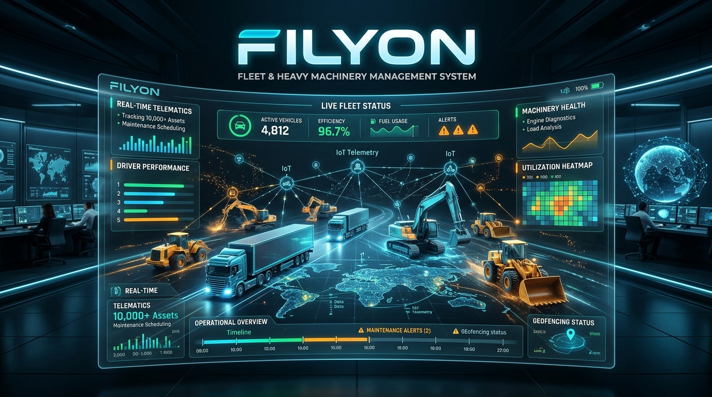

# FILYON: Kapsamlı Filo & Makine İkmal Yönetim Bilgi Sistemi



> **"Sıradaki Nesil Filo & Makine İkmal Yönetimi"**  
> Sayıştay Denetim ve 5018 Sayılı Kamu Malî Yönetimi ve Kontrol Kanunu standartlarına tam uyumlu, kurumsal çok kiracılı (multi-tenant) filo, iş makinesi ve atölye yönetim platformu.

---

## 1. Mimari Genel Bakış (Architecture & Stack)

FILYON; kurumsal ölçeklenebilirlik, yüksek tip güvenliği (type-safety) ve saha koşullarına dayanıklılık prensipleriyle tasarlanmış modern bir monorepo projesidir:

- **Veri Tabanı & ORM**: PostgreSQL 16 + Prisma ORM (Tüm tablolarda `tenantId` ile izole çok kiracılı yapı).
- **Backend API**: Node.js (TypeScript) + NestJS (Temiz katmanlı mimari, RBAC, Swagger, Cron-job).
- **Web Yönetim Paneli**: React 18 + Tailwind CSS + Lucide Icons + Recharts (Canlı telemetri, Sayıştay denetim raporları).
- **Saha Mobil Uygulaması**: React Native (Expo) (Şebeke olmayan sahalar için **Offline-First**, Kabin QR tarayıcı, ses kaydı ve fotoğraf desteği).
- **Orkestrasyon & Konteyner**: Tek komutla ayağa kalkabilen `docker-compose.yml`.

---

## 2. Profesyonel İş Kuralları (Core Business Logic)

### 🚨 1. Muayene Kilidi (Inspection Lock)
- Sistem, her aracın zorunlu TÜVTÜRK periyodik muayene ve trafik sigortası tarihlerini arka planda çalışan günlük cron görevleriyle (`08:00`) denetler.
- Muayene süresi dolan araçlar otomatik olarak `INSPECTION_EXPIRED` durumuna alınır.
- Sürücü veya filo yöneticisi araç kabinindeki QR kodu okuttuğunda veya panelden zimmet açmaya çalıştığında:
  > **`"🚨 MUAYENE KİLİDİ DEVREDE! Bu aracın yasal muayene tarihi dolmuştur. Göreve çıkamaz ve sürücüye zimmetlenemez!"`**  
  uyarısıyla işlem kesin olarak engellenir.

### 🔒 2. Hurda Kilidi (Sayıştay ve İç Denetim Uyumu)
- 5018 Sayılı Kanun ve Sayıştay denetim ilkeleri gereğince; atölyede bir araca yeni yedek parça (fren balatası, filtre, enjektör vb.) takıldığında, sökülen eski hurda parçanın kurum zararına veya gayriresmi satışa konu olmaması zorunludur.
- Usta yeni parçayı iş emrine bağladığında iş emri durumu `WAITING_SCRAP_CONFIRMATION` durumuna kilitlenir.
- **Kapatma Şartı**:
  1. Usta sökülen hurda parçanın net fotoğrafını sisteme yüklemelidir.
  2. Ambar Görevlisi (Storekeeper) hurdayı ambar teslim kutusuna fiziksel olarak teslim aldığını sistemde onaylamalıdır.
  3. Aksi takdirde iş emri kesinlikle kapatılamaz, faturalandırılamaz ve araç sefere verilemez!

---

## 3. Monorepo Klasör Yapısı

```
FİLYON/
├── backend/                  # NestJS API & Prisma ORM
│   ├── prisma/
│   │   ├── schema.prisma     # Çok kiracılı kurumsal Prisma şeması
│   │   └── seed.ts           # Demo araçlar, parçalar ve kilit senaryoları
│   ├── src/
│   │   ├── common/           # Roller, Guard'lar, Decorator'lar
│   │   ├── modules/
│   │   │   ├── auth/         # Login & Register (JWT & RBAC)
│   │   │   ├── vehicles/     # Araç ve iş makinesi envanteri, Muayene Kilidi
│   │   │   ├── zimmet/        # Kabin QR teslim & iade işlemleri
│   │   │   ├── work-orders/  # Atölye iş emirleri & Sayıştay Hurda Kilidi
│   │   │   ├── spare-parts/  # Ambar stok kartları, OEM kodları, raf takibi
│   │   │   ├── issue-reports/# Şoför sesli ve fotoğraflı arıza bildirimi
│   │   │   ├── analytics/    # Canlı telemetri dashboard ve resmi Sayıştay raporları
│   │   │   └── notifications/# Otomatik günlük muayene tarama Cron-job'ı
│   │   ├── app.module.ts
│   │   └── main.ts           # Swagger API dokümantasyonu (/docs)
│   ├── Dockerfile
│   └── package.json
│
├── frontend/                 # React 18 + Tailwind + Recharts Yönetim Paneli
│   ├── src/
│   │   ├── assets/           # image_0.png referans kapak ve görseller
│   │   ├── components/       # StatCard, MuayeneKilidiBadge, HurdaKilidiModal, QrModal
│   │   ├── context/          # AuthContext & Canlı Rol Değiştirici
│   │   ├── pages/
│   │   │   ├── DashboardPage.tsx     # Canlı Komuta Merkezi (image_0.png)
│   │   │   ├── VehiclesPage.tsx      # Araç & İş Makinesi Envanteri
│   │   │   ├── ZimmetPage.tsx        # QR Kabin Zimmet Testi (Muayene Kilidi)
│   │   │   ├── WorkOrdersPage.tsx    # İş Emirleri & Sayıştay Hurda Onayı
│   │   │   ├── SparePartsPage.tsx    # Ambar Stok, OEM Kodları & Raf Konumu
│   │   │   ├── IssueReportsPage.tsx  # Şoför Sesli Notu & Fotoğraflı Arızalar
│   │   │   ├── ReportsPage.tsx       # Sayıştay & İç Denetim Resmi PDF Cetveli
│   │   │   ├── CalendarPage.tsx      # Yasal Muayene ve Sigorta Takvimi
│   │   │   └── AuthPage.tsx          # Login & Register + Tek Tıkla Rol Seçimi
│   │   ├── App.tsx
│   │   └── index.css
│   ├── Dockerfile
│   └── package.json
│
├── mobile/                   # React Native (Expo) - Saha & Şoför Uygulaması
│   ├── src/services/
│   │   └── offlineSync.ts    # Çevrimdışı (Offline-First) yerel kuyruk motoru
│   ├── App.tsx               # Şoför QR Zimmet, Ses/Fotoğraf Arıza Bildirimi, Usta Hurda Yükleme
│   ├── app.json
│   └── package.json
│
├── docker-compose.yml        # PostgreSQL, NestJS API ve React SPA Tek Komut Kurulumu
├── .env.example              # Ortam değişkenleri şablonu
└── README.md                 # Detaylı Mimari ve Kurulum Kılavuzu
```

---

## 4. Hızlı Başlangıç & Kurulum

### Yöntem A: Docker Compose ile Tek Komutla Çalıştırma (Önerilen)

Tüm sistemi (PostgreSQL 16, NestJS Backend ve React Web Panel) başlatmak için:

```bash
docker-compose up -d --build
```

- **Web Yönetim Paneli**: [http://localhost:3000](http://localhost:3000)
- **Backend API**: [http://localhost:4000/api/v1](http://localhost:4000/api/v1)
- **Swagger API Dokümantasyonu**: [http://localhost:4000/docs](http://localhost:4000/docs)
- **PostgreSQL**: `localhost:5432` (Kullanıcı: `filyon_admin`, Şifre: `filyon_secure_pass_2026`)

---

### Yöntem B: Yerel Geliştirici Modu (Local Development)

#### 1. Web Paneli (Frontend)
```bash
cd frontend
npm install
npm run dev
# Panel http://localhost:3000 adresinde anında açılır.
```

#### 2. Backend API
```bash
cd backend
npm install
npx prisma generate
npx prisma db push # veya npx prisma migrate dev
npm run prisma:seed # Demo verileri yükler
npm run start:dev
```

#### 3. Saha Mobil Uygulaması (Expo)
```bash
cd mobile
npm install
npx expo start
```

---

## 5. Kullanıcı Rolleri & Yetki Matrisi (RBAC)

Giriş ekranında veya üst barda yer alan hızlı rol seçici ile aşağıdaki roller anında test edilebilir:

| Rol | Kod | Yetki Kapsamı |
| :--- | :--- | :--- |
| **Sistem Yöneticisi** | `ADMIN` | Tam sistem erişimi, kurum ayarları, denetim logları |
| **Filo Müdürü** | `MANAGER` | Filo maliyet analizi, Sayıştay raporları, araç alım/terkin |
| **Atölye Şefi** | `CHIEF` | İş emri açma, usta görevlendirme, iş emri kapatma |
| **Baş Usta / Mekanik** | `MECHANIC` | Arıza teşhisi, hurda parça fotoğrafı yükleme, onarım |
| **Ambar Sorumlusu** | `STOREKEEPER` | Yedek parça girişi, parça çıkışı, **Hurda teslim onayı** |
| **Sürücü / Operatör** | `DRIVER` | Kabin QR ile teslim alma, sesli ve fotoğraflı arıza açma |

---

## 6. Telif ve Lisans
FILYON Projesi, en son nesil filo ve makine ikmal teknolojileri ve kamu mevzuat uyumu gözetilerek üretilmiştir.
